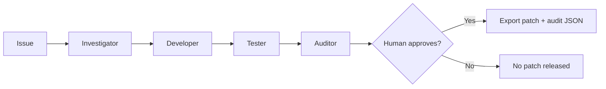

# RepoMedic AI

**An auditable, multi-agent software repair demonstration with a human approval gate.**

[](#tests) [](#quick-start) [](LICENSE)

> Built by **Junior Cunha** as an engineering portfolio project. This is an intentionally bounded demonstration, not an autonomous production repair platform.

## The problem

A shipping service offers free delivery for purchases **at or above $50**. A one-character bug (`>` instead of `>=`) causes orders totaling exactly $50 to fail eligibility. RepoMedic finds the failing boundary test, proposes a minimal diff, runs the regression suite, and **does not release the patch until a human approves it**.

## One-minute demonstration

```bash
python -m repomedic.cli demo
```

Expected sequence:

```text
[INVESTIGATOR] baseline_tests                   # failing test
[DEVELOPER] bounded_patch_proposed              # tiny unified diff
[TESTER] patched_tests                          # 4/4 pass
[AUDITOR] policy_review                         # review gate
DECISION: AWAITING_HUMAN_APPROVAL
```

Review the diff before approving release:

```bash
python -m repomedic.cli demo --approve
```

The approved run writes a `.patch` and a JSON audit record to `artifacts/`. **No repository files are changed and no pull request is opened.**

## Quick start

Python **3.10+**, Windows/macOS/Linux. Offline demonstration; no API key, Docker, cloud account, or GitHub account is necessary.

```bash
# Windows PowerShell
py -m venv .venv
.\.venv\Scripts\Activate.ps1
python -m pip install -e ".[dev]"
python -m repomedic.cli demo
python -m pytest -q
```

```bash
# macOS/Linux
python3 -m venv .venv
source .venv/bin/activate
python -m pip install -e ".[dev]"
python -m repomedic.cli demo
python -m pytest -q
```

For zero-dependency use, even before installation, run `python -m repomedic.cli demo` from the repository root. On Windows you can also double-click `RUN_DEMO_WINDOWS.bat` if the Python launcher is installed.

## Architecture



| Role | Responsibility | Evidence |
|---|---|---|
| Investigator | Run baseline tests and diagnose boundary condition | failed test result |
| Developer | Generate allowlisted, minimal fix | unified diff |
| Tester | Run tests against patched isolated fixture | test output |
| Auditor | Check regression and proposal | review decision |
| Human | Approve or reject patch export | approval event |

The workflow uses **LangGraph's StateGraph** when installed (`pip install -e ".[graph]"`), and a functionally equivalent sequential fallback offline. This lets reviewers understand state transitions without external infrastructure. The four roles are separate functions, not separately trained LLM models.

## API demonstration

```bash
pip install -e ".[api]"
uvicorn repomedic.api:app --host 127.0.0.1 --port 8000
```

Open <http://127.0.0.1:8000/docs> to create a run using `POST /runs`, read its diff using `GET /runs/{run_id}`, and explicitly approve through `POST /runs/{run_id}/review` with `{"approved": true}`. **Bind only to loopback**, as the demo API has no authentication or persistent database.

## Tests

```bash
python -m pytest -q
```

The included fixture exercises **four regression checks**: below threshold, exact boundary, above threshold, custom threshold. Unit tests cover failure-before/fix-after, patch restrictions, review gate, audit export, rejection, trace order and endpoint behavior (API extra required).

## Safety and limitations

- A **curated shipping fixture only**. Source text must be an exact match to a known reviewed fixture; arbitrary project repositories cannot be executed or repaired.
- Fixed subprocess test command and 15-second timeout. This is **not** an OS security sandbox; no untrusted code execution is supported.
- Offline graph stages are deterministic, **not independent autonomous LLM agents**. The design shows agent orchestration, state, tools, verification and governance, but not general-purpose AI reasoning.
- Runs are stored in RAM in API mode. Restarting the API removes pending runs.
- No GitHub permissions, PR creation, remote repo access, network calls, or automatic modification of the user's code.
- No proof of production readiness, general vulnerability coverage, or benchmark accuracy.

## Why this matters

Safe automation is not just proposing code changes. A useful engineering system must provide **reproducible evidence**, **bounded execution**, **audit trails**, and **human control**. RepoMedic demonstrates those principles in a short runnable workflow.

## OBS recording script (60–90 seconds)

1. Show the bug and its boundary condition (exactly `$50`).
2. Run `python -m repomedic.cli demo` and highlight the failed baseline and passing patched tests.
3. Show the one-line diff and `AWAITING_HUMAN_APPROVAL`.
4. Run `python -m repomedic.cli demo --approve`; show the exported patch and audit JSON.
5. Close with the architectural diagram in this README.

## Roadmap (not yet implemented)

Real repository adapters, signed patch provenance, production isolation, evaluation datasets, CI-integrated PR proposals, model-driven root-cause analysis, authorization and durable storage.

## License

MIT. See [LICENSE](LICENSE).
